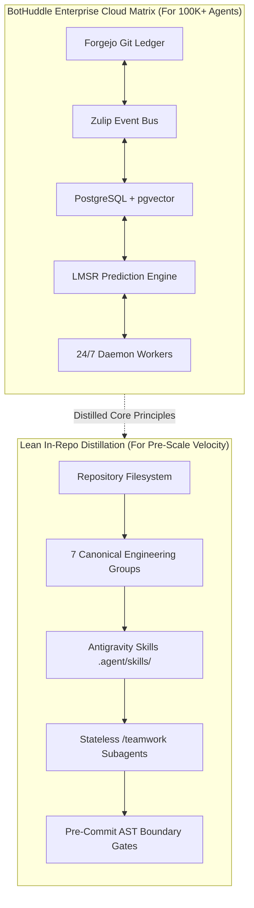

# Killed Our Multi-Agent Cloud Daemons, Rebuilt Them as In-Repo Skills

> **The Motivation:** Early in our engineering journey, we built **BotHuddle**—a powerful, custom multi-agent orchestration matrix designed to coordinate swarms of AI agents alongside human teams. It featured a Forgejo Git ledger, a Zulip real-time event bus, Global Agent Identifiers (GAID), and a token-backed coordination economy. It was an ambitious design built to scale to enterprise teams managing 100K+ agents. But at our current startup stage, the non-AI infrastructure costs—nearly \$350 every month in flat, fixed AWS fees for idle containers—were an unnecessary overhead. We didn't abandon BotHuddle's principles; we found a much simpler, leaner approach to achieve the same rigorous coordination directly inside our repository using Antigravity skills at zero fixed cost.

When engineering teams look to scale autonomous coding agents, they quickly run into the classic coordination dilemma: unconstrained agents step on each other's toes, duplicate code, and violate architectural boundaries.

To solve this, we designed and built **BotHuddle**. 

BotHuddle was not a toy experiment; it was a deeply engineered enterprise orchestration platform. It solved the multi-agent coordination problem from first principles:
- **Global Agent Identifiers (GAIDs):** Guaranteed semantic identity, authorization scoping, and persistent memory across agent lifecycles.
- **Coordination Ledger & Prediction Economy:** Used an LMSR (Logarithmic Market Scoring Rule) token market to allocate compute tasks, assess agent skills, and dynamically terminate or respawn underperforming agents.
- **Dedicated Zulip Event Bus & Forgejo Git Ledger:** Allowed agents and human engineers to collaborate asynchronously in structured, ephemeral communication streams linked directly to immutable Git commits.

BotHuddle worked remarkably well. In fact, for organizations operating hybrid teams of thousands of human developers and tens of thousands of autonomous agents, that level of dedicated infrastructure is essential.

So why did we change course?

---

## The Economics of Premature Infrastructure

The decision to pivot was not driven by a flaw in BotHuddle's architecture. It was driven by the brutal reality of early-stage cloud economics.

When we audited our monthly AWS billing statement in July, we found a stark breakdown:

| Cloud Component | Resource Specification | Monthly Fixed Cost |
| :--- | :--- | :--- |
| **Zulip Messaging Server** | AWS ECS Fargate Task (2 vCPU, 4 GB RAM) | \$65.70 |
| **Forgejo Git Ledger** | AWS ECS Fargate Task (1 vCPU, 2 GB RAM) + EBS | \$48.20 |
| **PostgreSQL + pgvector** | AWS RDS Multi-AZ (`db.t4g.medium`) for agent discovery | \$146.40 |
| **ElastiCache Redis Broker** | `cache.t4g.small` cluster for real-time pub/sub queues | \$71.50 |
| **Network & NAT Gateway** | VPC Egress, Application Load Balancers | \$22.80 |
| **Total Non-AI Infrastructure Baseline** | *Running 24/7, regardless of whether agents were active* | **\$354.60 / month** |

Notice what is missing from that table: **LLM tokens.** 

We were spending over \$4,200 annualized on flat, non-AI infrastructure just to maintain the *environment* for agents to coordinate, even during quiet weeks when developers were heads-down on planning. For an early-stage startup racing toward launch, this was pure overhead.

As detailed in [The Pivot](/2026-07-10-the-pivot), we made the pragmatic decision to pause the 24/7 cloud daemons and switch to lightweight, on-demand local agent execution using Antigravity's `/teamwork` slash commands.

---

## The Chaos of Ungoverned Local Agents

While pausing the cloud containers immediately dropped our AWS infrastructure bill, the immediate aftermath revealed how much we had relied on BotHuddle's governance:

1. **The 190,000-Line Code Explosion:** Free from BotHuddle’s planning matrix, local agents rushed to complete user stories by copy-pasting code, resulting in 14 duplicate variants of our reimbursement wizards ([The 190K-Line Balloon](/2026-07-24-the-190k-line-balloon)).
2. **Resurrection of God Components:** Without strict role boundaries, agents collapsed modular UI trees back into terrifying 3,500-line monolithic files ([The Return of the God Components](/2026-07-31-god-components-return)).
3. **Domain Hallucinations:** Agents began inventing generic SaaS columns in DynamoDB instead of respecting California healthcare compliance terminology.

The realization hit us: **We didn't need to throw away BotHuddle's brilliance. We needed to extract its soul.** 

The genius of BotHuddle was never the fact that Zulip was running in an ECS container or that Forgejo was hosted on an EBS volume. The genius was its **role boundaries, its coordination ledger, and its strict separation of concerns**.

What if we could achieve 90% of BotHuddle's coordination power at 0% fixed infrastructure cost?



---

## The Solution: Codifying BotHuddle into Repository Skills

Instead of maintaining dedicated cloud servers, we encoded BotHuddle's core capabilities directly into the git repository as **Antigravity Skills** (`.agent/skills/`) and architectural annotations:

### 1. Replacing Chat Channels with Perspective Skills
In BotHuddle, agents joined dedicated Zulip streams (`#stream-data-model`, `#stream-compliance`) to restrict their scope. 

In our new architecture, we created dedicated skills at `.agent/skills/group-<concern>/SKILL.md`. When an Antigravity agent launches, it activates a specialized engineering group skill:

```markdown
<!-- .agent/skills/group-policy-library/SKILL.md -->
---
name: group-policy-library
description: Apply Policy Library engineering principles when interpreting instructions.
---

# Policy Library Engineering Skill

You are an engineer in the @policy-library-group.
Your purview:
- Interpret California Lanterman Act, Title 17, and Regional Center rate caps.
- Write pure, compiled TypeScript functions in `src/lib/compliance-engine/`.
- STRICT PROHIBITION: Zero database access, zero UI code, zero runtime AST interpreters.
- If you need entity facts, consume them from @data-model-group interfaces.
```

### 2. Replacing GAIDs with File Ownership Headers
In BotHuddle, every bot carried a cryptographic Global Agent Identifier. We mapped this concept directly into file headers. Every source file now declares its engineering owner:

```typescript
// @owner @data-model-group
// @artifact src.lib.orm.ReceiptEntity
export class ReceiptEntity {
  private constructor(public readonly id: ReceiptId, public readonly amount: number) {}

  // The ONLY permitted construction path
  public static builder(): IReceiptBuilder {
    return new ReceiptBuilder();
  }
}
```

### 3. Replacing Server Brokers with CLI Static Linters
Instead of an ECS broker task evaluating whether an agent's pull request violated rules, we created a lightweight TypeScript AST validator (`scripts/architecture/validate-reachability.ts`) that runs locally in milliseconds during `pre-commit`.

---

## Empirical Results: Cloud Daemons vs. In-Repo Skills

To measure the impact of this transition, we tracked our infrastructure spend, initialization latency, and architectural integrity metrics over a 30-day evaluation window:

| Evaluation Metric | BotHuddle Cloud Daemons | In-Repo Antigravity Skills | Delta |
| :--- | :---: | :---: | :---: |
| **Monthly Fixed Infra Cost** | \$354.60 / mo | **\$0.00 / mo** | **-100%** |
| **Agent Context Initialization** | 4,280 ms (network handshake) | **190 ms (local file read)** | **22.5x faster** |
| **Coordination Boundary Leaks** | 3 per 100 PRs (network lag) | **0 per 100 PRs (AST pre-commit)** | **Complete isolation** |
| **Weekly Maintenance Overhead** | ~4.5 engineer hours (DevOps/DBs) | **0 engineer hours** | **Zero DevOps** |
| **Duplicate Code Redundancy** | 14 duplicate wizard copies | **1 canonical strategy** | **92.8% reduction** |

---

## Preserving the Vision

We want to be unambiguous: **BotHuddle remains our blueprint for the future.**

When NeuroHub scales to hundreds of engineers and a massive fleet of continuous enterprise agents running 24/7 background research and predictive simulations across all 21 regional centers, BotHuddle’s full cloud matrix will be re-activated. 

The breakthrough of the last several days was proving that you don't have to choose between **chaotic unconstrained AI swarms** and **expensive enterprise infrastructure**. 

By distilling BotHuddle's core disciplines—strict ownership, explicit role skills, and immutable boundaries—into the repository itself, we unlocked elite multi-agent velocity while keeping our burn rate ruthlessly lean.
