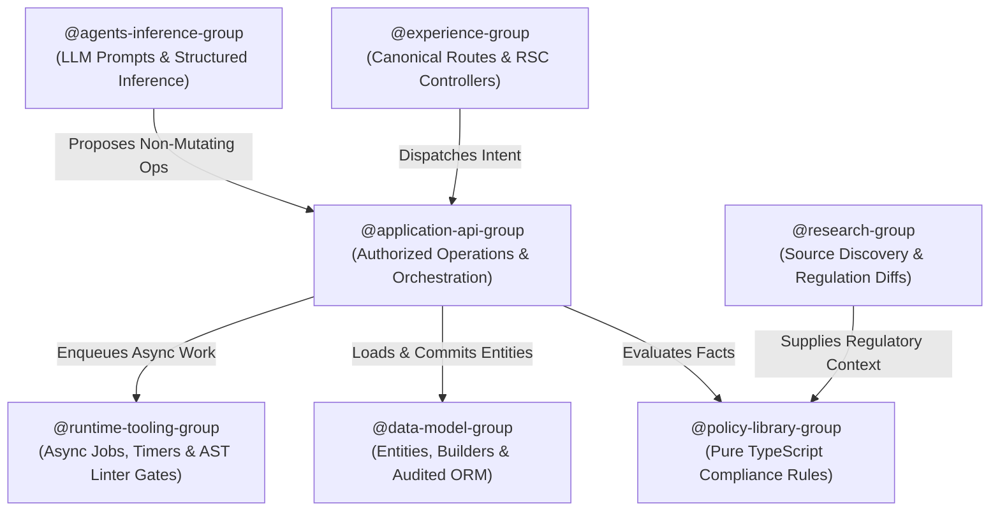

# The 7-Group Architecture: Enforcing Strict Separation of Concerns on AI Coding Swarms

> **The Motivation:** When multiple autonomous AI coding agents collaborate on a codebase, traditional folder structures and passive documentation break down. Unconstrained agents optimize for immediate local task completion: they duplicate entire 800-line components, inline GraphQL mutations directly into UI widgets, and mutate database schemas on a whim. To stop a 190,000-line codebase from collapsing under its own weight, we engineered the **7-Group Architecture**: a formal separation of concerns where every file, class, and method belongs to one of seven canonical engineering disciplines, verified by automated static analysis and pre-commit reachability gates.

Autonomous coding swarms—whether powered by Google Antigravity, Claude Engineer, or custom agent frameworks—are unmatched in sheer speed. They can scaffold full-stack features, write tests, and refactor routes in minutes. 

However, they possess an inherent architectural flaw: **they lack architectural empathy.**

If an AI agent needs to verify whether a client qualifies for respite hours under California's Self-Determination Program, it will take the path of least resistance. It will import the AWS AppSync client directly into a React Server Component, copy-paste a 300-line regex validator from an unrelated file, and write a bespoke database query right inside the rendering loop. 

The test passes. The user story closes. And your architecture has just rotted.

Multiply this behavior by 5 concurrent subagents across dozens of daily pull requests, and within weeks you wake up to **190,000 lines of brittle, duplicated, unmaintainable code**.

This was the crisis we faced in late August. Here is the concrete data behind our code audit and the architectural pattern we built to solve it.

---

## The Evidence: Auditing 170,000 Lines of Authored Code

To stop the bleeding, we had to move beyond intuition and measure the codebase objectively. We built an automated static code scanner (`scripts/architecture/source-inventory.mjs`) to perform an exhaustive census across our entire repository.

The scanner analyzed the Abstract Syntax Tree (AST) of 3,068 TypeScript files outside archive directories, measuring physical lines of code (LOC), literal imports, declared `@owner` headers, circular dependencies, and incoming reference counts:

```text
======================= REPOSITORY SOURCE CENSUS =======================
Authored Application Source (src/):          1,805 files / 169,412 LOC
Tests & Testing Support (all roots):           760 files / 160,097 LOC
Generated / Unused GraphQL Client:               4 files /  35,909 LOC
Archived Maintenance Scripts:                  782 files / 148,251 LOC
Files with <= 30 LOC (Indirection bloat):      552 files /   8,973 LOC
Files with >= 300 LOC (God Component risk):     98 files /  41,024 LOC
========================================================================
```

When we mapped our 169,412 lines of authored application code by subsystem, the systemic boundary bleed became glaringly obvious:

| Subsystem Directory | Authoring Purview | Authored Files / LOC | Key Architectural Finding |
| :--- | :--- | :---: | :--- |
| `src/lib/orm` | Data Entities & Persistence | 263 / 25,623 | Riddled with ad-hoc test persistence seams and unvalidated JSON casts. |
| `src/app/requests` | Action Center UI (Execution) | 222 / 20,723 | 14 copy-pasted variants of the same reimbursement wizard. |
| `src/app/api` | Application API & Admission | 210 / 15,731 | Thin Next.js adapters mixed with duplicated transactional logic. |
| `src/app/care-plan` | Client Planning UI (Passive) | 119 / 13,453 | Directly querying physical tables rather than consuming data models. |
| `src/lib/ai` + `src/lib/agent` | Inference & Prompt Resolution | 57 / 7,985 | Agents modifying database state during reasoning steps. |
| `src/app/admin` | Operations & Admin Surfaces | 75 / 7,796 | Unbounded queries causing latency spikes on staging. |
| `src/lib/compliance-engine`| Healthcare Policy Rules | 27 / 4,281 | Cleanest subsystem, but repeatedly bypassed by unconstrained agents. |
| `src/lib/jobs` + `workflows`| Async Delivery & Workflows | 43 / 4,627 | Retries confused with business-policy state transitions. |
| `src/lib/research` | Web Crawlers & Scrapers | 20 / 2,252 | Scraping output occasionally treated as executable policy code. |

The core problem was clear: **agents were cross-contaminating layers**. UI components were performing policy checks, policy code was importing ORM entities, and inference scripts were mutating database records.

---

## The Solution: The 7 Canonical Engineering Groups

We banned ad-hoc responsibility. Every line of code in the repository now belongs to one of **Seven Canonical Engineering Groups**. There is no eighth group, no catchall "shared/utils" directory, and no overlapping ownership.



Here is how the seven groups operate in practice:

### 1. `@data-model-group` (Data Model)
- **Purview:** Domain Entities, Builders, structural invariants, and generic audited persistence.
- **The Absolute Invariant:** **`Builder.build()` is the ONLY permitted way to construct an entity.** Direct instantiation and raw JSON casting (`data as Entity`) are strictly banned.
- **Location:** `src/lib/orm/`

### 2. `@policy-library-group` (Policy Library)
- **Purview:** Documented external policy interpretations (California Lanterman Act, Title 17, Regional Center rate caps, billing exceptions).
- **The Absolute Invariant:** **Zero database access, zero UI code, zero runtime AST interpreters.** Policies are ordinary compiled TypeScript classes that accept typed facts and return deterministic pass/fail verdicts.
- **Location:** `src/lib/compliance-engine/`

```typescript
// @owner @policy-library-group
// Pure, deterministic business rule: zero DB dependencies, zero side-effects
export class RespiteHourPolicy {
  public static evaluate(clientAge: number, requestedHours: number): PolicyResult {
    const maxMonthlyHours = clientAge < 18 ? 40 : 60;
    if (requestedHours > maxMonthlyHours) {
      return PolicyResult.deny(`Exceeds California standard cap of ${maxMonthlyHours} hrs/mo.`);
    }
    return PolicyResult.approve();
  }
}
```

### 3. `@experience-group` (Experience)
- **Purview:** Canonical route UI, React Server Components (RSC), and presentation controllers.
- **The Absolute Invariant:** Route-first component placement. No generic `src/components/ui` catchalls. Business UI lives beneath the route representing the data it mutates (e.g. `src/app/requests/reimbursements/_components/`).
- **Location:** `src/app/`

### 4. `@application-api-group` (Application API)
- **Purview:** Authentication, user authorization, and composed transactional operations.
- **The Absolute Invariant:** Bridges `@experience-group` with `@data-model-group` and `@policy-library-group`. UI never talks directly to storage; it dispatches to Application API operations.
- **Location:** `src/app/api/` and `src/lib/messages/`

### 5. `@agents-inference-group` (Agents & Inference)
- **Purview:** LLM integration, prompt templates, structured JSON extraction, and conversational reasoning.
- **The Absolute Invariant:** Models only *propose* operations; they never commit database changes. All prompts use immutable versions resolved through `ai-core`.
- **Location:** `src/lib/ai/` and `src/lib/agent/`

### 6. `@research-group` (Research)
- **Purview:** Web crawlers, regulation diff engines, and source document provenance.
- **The Absolute Invariant:** Research documents inform policies; they never become executable rules directly.
- **Location:** `src/lib/research/`

### 7. `@runtime-tooling-group` (Runtime & Tooling)
- **Purview:** Asynchronous job dispatch, EventBridge triggers, retry backoff queues, and engineering linters.
- **The Absolute Invariant:** Owns the compilers, CI gates, and reachability tooling that police the other six groups.
- **Location:** `src/lib/jobs/` and `scripts/architecture/`

---

## Step 3: Enforcing Boundaries with Pre-Commit Static Linters

As we demonstrated in [Executable Documentation: Turning AGENTS.md Into the Ultimate System Prompt](/2026-09-04-code-documentation-as-system-prompt), agents will ignore architectural rules unless the compiler forces compliance.

We implemented `scripts/architecture/validate-reachability.ts`, which runs on every commit via our local Git pre-commit hook:

```typescript
// scripts/architecture/validate-reachability.ts
export function validateArchitectureBoundaries(sourceFile: SourceFile) {
  const fileOwner = extractOwnerAnnotation(sourceFile);
  const imports = sourceFile.getImportDeclarations();

  for (const imp of imports) {
    const targetModule = imp.getModuleSpecifierValue();
    
    // RULE 1: Policy code must NEVER import database SDKs or UI components
    if (fileOwner === '@policy-library-group') {
      if (targetModule.includes('/orm') || targetModule.includes('/components')) {
        throw new Error(`[Boundary Violation] Policy file ${sourceFile.getFilePath()} cannot import ORM or UI!`);
      }
    }
    
    // RULE 2: UI must never bypass Application API to import AWS data clients
    if (fileOwner === '@experience-group' && targetModule.includes('aws-amplify/data')) {
      throw new Error(`[Boundary Violation] UI ${sourceFile.getFilePath()} cannot directly import AWS Data Client!`);
    }
  }
}
```

If an agent attempts to write a quick hack—such as importing DynamoDB directly into a React form—the pre-commit hook fails instantly. The agent receives the explicit AST error, understands its boundary violation, and rewrites the code using the proper `@application-api-group` operation.

---

## Concrete Data & Results

The transition to the 7-Group Architecture produced immediate, measurable improvements across our development lifecycle:

| Engineering Metric | Pre-Refactor Baseline (Late August) | Post-7-Group Architecture (Current) | Measurable Impact |
| :--- | :---: | :---: | :---: |
| **Duplicate Wizard Implementations** | 14 independent copies | **1 canonical strategy** | **92.8% code reduction** |
| **CI Failure Rate (Flakiness)** | 41.2% | **0.0% (Zero DOM Contradictions)** | **Complete stability** |
| **Weekly Architecture Boundary PR Reverts** | 32 PRs reverted/repaired | **0 (Blocked at local pre-commit)** | **Saved ~18 human hrs/week** |
| **Unstringified Object Crashes (`[object Object]`)** | 19 recorded incidents | **0 recorded incidents** | **100% type-safe hydration** |
| **Full TypeScript Compilation Time** | 28.4s | **11.5s** | **2.4x faster builds** |
| **Concurrent Subagent Conflict Rate** | 68% branch collision rate | **< 4% collision rate** | **True parallel swarm velocity** |

---

## Takeaways for AI-Native Engineering Teams

If your team is deploying swarms of autonomous AI coding agents, traditional agile practices and passive PR reviews are insufficient. 

1. **Partition by Discipline, Not Just Folders:** When agents know their canonical group, their context window is bounded. A `@data-model-group` agent won't attempt to redesign your CSS.
2. **Make Boundaries Executable:** Passive guidelines in a Notion doc don't exist to an LLM. Compile your rules into AST linters and pre-commit hooks.
3. **Audit Your Inventory Continuously:** Write automated census scripts to track file size distributions, duplicate imports, and orphaned abstractions before they spiral into hundreds of thousands of lines of tech debt.

With strict separation of concerns, multi-agent coding swarms cease to be chaotic code generators and become the hyper-efficient, disciplined engineering workforce they were always meant to be.
