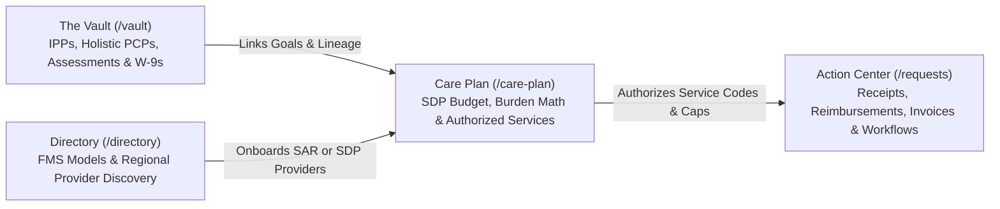

# Announcing the NeuroHub GA Release: Grounded Support, Organization, and Clarity for Regional Center & SDP Families

> **Our Core Promise at GA:** Anyone with lived experience in California's Regional Center system or the Self-Determination Program (SDP) knows there is no "magic bullet" or panacea that makes state bureaucracy disappear overnight. When we interviewed Support Group Executive Directors, Independent Facilitators, and parents earlier this year, their message was unmistakable: *do not promise families guaranteed instant approvals or claim that AI can replace human judgment. Give us the information, organization, and preparation tools to navigate a bumpy road more smoothly.* Today, with our General Availability (GA) release, that is exactly what NeuroHub delivers.

Over the past six months, we have chronicled our engineering journey on this blog—from [building a deterministic TypeScript Compliance Engine](/2026-09-02-building-the-compliance-engine) and [enforcing our 7-Group Architecture](/2026-09-17-the-7-group-agentic-architecture) to [banning unvalidated JSON with strict ORM Builders](/2026-09-18-strict-orm-builders).

Every one of those architectural decisions served a single human goal: building a trustworthy, desktop-class workspace for **Parents**, **Independent Facilitators (IFs)**, **Providers**, and **Service Coordinators** navigating Regional Center services.

Today, we are excited to open our **Customer Advisory Board Beta & General Availability (GA) Release**—and to share how direct feedback from the community shaped every workflow in the platform.

---

## 1. What Our Pre-Launch Interviews Taught Us

Before writing a line of our Milestone 2 and GA workflows, we sat down with Support Group Executive Directors, veteran Independent Facilitators, and families across both the **Traditional (SAR)** and **Self-Determination Program (SDP)** tracks. Three insights fundamentally shaped the product we are launching today:

### Insight 1: "No Panaceas—Respect Lived Experience"
When we spoke with the Executive Director of a regional family support group, she gave us a candid warning:
> *"The Regional Center system is broken. Anyone with lived experience knows there is no magic solution. If you pitch software as a panacea that solves everything automatically, seasoned advocates and parents will immediately tune out. AI can list FMS firms and organize documents, but it cannot guarantee which FMS or provider is actually competent. Position NeuroHub as providing information, organization, and support to navigate a bumpy road more smoothly."*

That conversation became a permanent engineering and product invariant at NeuroHub. Our UI and AI assistant (**Ninja**) never claim that clicking a button guarantees an external Regional Center or FMS approval, and our **Directory** (`/directory`) clearly distinguishes searchable factual listings from human-vetted clinical experience.

### Insight 2: The 60–90 Day Traditional Reimbursement Bottleneck & Holistic PCPs
In our interviews with Independent Facilitators, we initially hypothesized that IFs needed software to invoice for their own facilitation services. They quickly corrected us:
- **IF Self-Invoicing Isn't the Bottleneck:** IFs invoicing for their own hours is already straightforward. The real, hair-on-fire pain point for families is the **[60-to-90-day reimbursement cycle in the Traditional Regional Center model](/2026-09-21-speed-up-regional-center-reimbursements)**—where a single missing Tax ID, unitemized receipt, or vague service description gets a packet kicked back after two months of waiting.
- **A PCP Is Not a Mechanical Copy of an IPP:** Writing a **Person-Centered Plan (PCP)** requires deeply understanding the child's and family's holistic goals, strengths, and daily context so the IF can advocate for the right services—never just running a mechanical form conversion on an old IPP.

### Insight 3: 1099 Business Setup, FMS Burden Math & Collaborative Spending Plans
Our deep-dive interviews on SDP vendorization and spending plans revealed where IFs and parents lose dozens of hours during SDP transitions:
- Mapping a certified budget (e.g., `$50,000`) across specific Regional Center service codes while accounting for **monthly FMS fees** and **employer payroll tax / workers' compensation burden** (`rcMath`).
- Explaining to independent providers (and parents hiring personal assistants) that under a Bill Payer FMS track, **[the FMS pays businesses on an invoice basis](/2026-10-27-hiring-direct-respite-workers)**—requiring an EIN/W-9, business invoicing, and clear **SAR (Reimburse)** vs. **SDP (Invoice)** alignment.
- Getting explicit **parent review and approval** on Spending Plan drafts and budget change requests before submitting updates to the Regional Center and FMS.

---

## 2. What Is Included in the NeuroHub GA Platform

We organized the NeuroHub GA experience around clear, addressable workspaces that separate passive record storage from active workflow execution:

### The Vault (`/vault`): Holistic Records & IPP/PCP Lineage
- **Passive Record Store:** Store and organize Individual Program Plans (IPPs), IPP Addenda, holistic Person-Centered Plans (PCPs), clinical assessments, and vendor documentation in one place.
- **Goal-Driven Lineage:** Extracted IPP goals link directly to authorized services and retain full version and parent-document lineage during revisions.

### The Action Center (`/requests`): Taming the 60–90 Day Reimbursement Cycle
- **Active Execution Workspace:** Every Receipt, Reimbursement packet, SDP Invoice, and IPP/Budget Change Workflow lives at a dedicated, full-page URL with clean status pill filters (**Drafts**, **In Progress**, **Completed**).
- **Pre-Submission Audit Readiness:** Upload a receipt or forward an invoice, verify itemized dates/hours and vendor details, link it to the matching IPP goal, and review the complete packet before sending it to your Service Coordinator or FMS.

### Collaborative Care Plan & SDP Budget Builder (`/care-plan/budget` & `/care-plan/services`)
- **Shared Family + IF Workspace:** Parents and their invited Independent Facilitators collaborate on the same live Spending Plan records—moving cleanly through draft, review, parent approval, and revision states without emailing conflicting spreadsheets back and forth.
- **Built-In FMS & Burden Calculator:** Automatically calculate gross vs. net service allocations across [Bill Payer, Co-Employer, and Sole Employer FMS models](/2026-11-04-ultimate-guide-fms-models).

### Ninja Assistant (`/ninja`): Prepared Drafts, Never Forced Conversations
- Use standard upload and form workflows whenever you want direct data entry—or hand complex, multi-page documents to **Ninja** to prepare a draft and open the canonical Review step with populated facts, remaining gaps, and required user acknowledgements clearly highlighted.

---

## 3. Continuous Validation: Simulating Our Interviewed Personas with Local LLMs

To ensure we never drift from the real-world skepticism of our users, we baked our June 2026 customer interviews directly into our automated E2E verification suite (`e2e/cab-interview-persona-feedback.spec.ts`).

Before a release ships, our local vision-language judge (`USE_LOCAL_LLM=true`) evaluates live application screens through the eyes of four interviewed personas:
1. **`interview_executive_director`:** Audits public and directory pages to ensure zero "magic bullet" overpromises and clear, empathetic framing.
2. **`interview_if_reimbursement_advocate`:** Verifies that the IF workspace and Action Center prioritize holistic PCP/IPP context and 60–90 day reimbursement relief.
3. **`interview_if_vendorization_spending_plan`:** Inspects `/care-plan/budget` and `/care-plan/services` for service-code mapping, FMS tax/labor burden visibility, and 1099 invoice vs. SAR reimbursement clarity.
4. **`interview_parent_traditional_sdp_bridge`:** Evaluates the clarity of the Vault vs. Action Center separation and status pill filtering for busy parents.

---

## 4. Simple Pricing & How to Join Our Customer Advisory Board Rollout

We want every advocate and family to be able to work together without friction:

- **Independent Facilitators (IFs), Providers & Service Coordinators:** **100% Free.** Collaborate with your client families, prepare PCPs and Spending Plans, and track service authorizations at no cost.
- **Parent Plan:** **$9.99/month** (with a **Founding Advisory Member** rate for early Customer Advisory Board families). If organizing your Vault, catching receipt formatting errors upfront, and keeping your SDP budget balanced saves you even one kicked-back reimbursement packet, NeuroHub pays for itself many times over.

### Get Started with NeuroHub
Whether you are a parent organizing IPP documents and reimbursements, an Independent Facilitator building Person-Centered Plans and SDP Spending Plans, or an independent provider coordinating with client families, you can get started directly on desktop today:

- **Get Started on NeuroHub:** [https://neurohubcare.com/home/get-started](https://neurohubcare.com/home/get-started)

Thank you to every parent, Independent Facilitator, provider, and support group leader who shared their time and lived experience with us. The road through Regional Center and SDP paperwork is still bumpy—but you no longer have to navigate it with a shoebox of receipts and a dozen disconnected spreadsheets.
