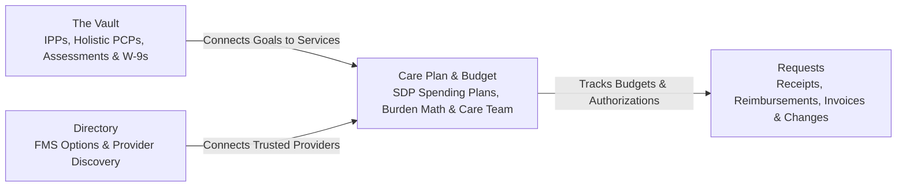

# Introducing NeuroHub: Grounded Support, Organization, and Clarity for Regional Center & SDP Families

> **Our Core Promise:** Anyone with lived experience in California's Regional Center system or the Self-Determination Program (SDP) knows there is no "magic bullet" or panacea that makes state bureaucracy disappear overnight. When we interviewed Support Group Executive Directors, Independent Facilitators, service providers, and parents earlier this year, their message was unmistakable: *do not promise families guaranteed instant approvals or claim that software can replace human judgment. Give us the information, organization, and preparation tools to navigate a bumpy road more smoothly.* Today, as NeuroHub opens to families and care teams across California, that is exactly what we deliver.

Over the past several months, we worked side by side with **Parents**, **Self-Advocates**, **Independent Facilitators (IFs)**, **Service Providers**, and **Service Coordinators** to build a calm, trustworthy home for day-to-day Regional Center and SDP care administration.

Today, **NeuroHub is officially live**—and we want to share how direct feedback from the community shaped every part of the product.

---

## 1. What Families, Facilitators & Providers Taught Us

Before designing NeuroHub's workflows, we sat down with Support Group Executive Directors, veteran Independent Facilitators, service providers, and families across both the **Traditional Regional Center** and **Self-Determination Program (SDP)** pathways. Three insights shaped everything you see in NeuroHub today:

### Insight 1: "No Panaceas—Respect Lived Experience"
When we spoke with the Executive Director of a regional family support group, she gave us a candid warning:
> *"The Regional Center system is broken. Anyone with lived experience knows there is no magic solution. If you pitch software as a panacea that solves everything automatically, seasoned advocates and parents will immediately tune out. Technology can list FMS firms and organize documents, but it cannot guarantee which FMS or provider is actually competent. Position NeuroHub as providing information, organization, and support to navigate a bumpy road more smoothly."*

That conversation became a permanent promise at NeuroHub. Our workspace and our assistant (**Ninja**) never claim that clicking a button guarantees an external Regional Center or FMS approval, and our **Provider & FMS Directory** clearly distinguishes factual listings from personal family experience.

### Insight 2: The 60–90 Day Reimbursement Bottleneck & Holistic Planning
In our early interviews with Independent Facilitators, we initially assumed IFs needed software primarily to bill for their own facilitation hours. They quickly set us straight:
- **Family Reimbursements Are the Real Bottleneck:** Billing for facilitation hours is already straightforward. The real, exhausting pain point for families is the **[60-to-90-day reimbursement cycle](/2026-09-21-speed-up-regional-center-reimbursements)**—where a single missing Tax ID, unitemized receipt, or vague service description gets a packet kicked back after two months of waiting.
- **A Person-Centered Plan Is Not a Mechanical Copy of an IPP:** Writing a **Person-Centered Plan (PCP)** requires deeply understanding the individual's holistic goals, strengths, and daily life so the team can advocate for the right supports—never just copying boxes from an old IPP.

### Insight 3: Direct Provider Setup, FMS Burden Math & Shared Spending Plans
Our conversations around SDP transitions and spending plans highlighted where families and facilitators lose dozens of hours:
- Mapping a certified budget across Regional Center service categories while accounting for **monthly FMS fees** and **employer payroll tax and workers' compensation costs**.
- Helping independent providers and personal assistants understand how **[FMS invoice payment works](/2026-10-27-hiring-direct-respite-workers)**—keeping Traditional reimbursements and SDP vendor invoices clearly organized.
- Giving parents and Independent Facilitators a single place to review and approve Spending Plan drafts and budget updates before sending paperwork to the Regional Center and FMS.

---

## 2. What You Can Do in NeuroHub Today

NeuroHub brings your records, reimbursements, budgets, and care team into clear, focused workspaces:

### The Vault: Start with One IPP or Receipt
- **No Need to Wait for a Complete Binder:** You can start with just **one IPP or one receipt**—and you can even upload out-of-pocket receipts before adding your IPP.
- **One Secure Home for Core Records:** Store and organize Individual Program Plans (IPPs), IPP Addenda, Person-Centered Plans (PCPs), clinical assessments, and provider documents in one place.
- **Clear Goal Connections:** Connect IPP goals directly to authorized services and keep a clean history as plans are updated from year to year.

### Requests: Taming the 60–90 Day Paperwork Cycle for Both Traditional & SDP
- **Built for Both Pathways:**
  - **For Traditional Regional Center Services:** Connect paid out-of-pocket receipts to your child's authorized services and IPP goals, then prepare a clean reimbursement packet for your Service Coordinator.
  - **For Self-Determination (SDP):** Upload provider invoices and prepare formatted copies ready for Financial Management Service (FMS) review.
- **Clear Extraction Confidence Badges (`0%–100%`):** When you upload a receipt or invoice, NeuroHub displays clear percentage confidence badges (`90%+` high confidence, `70%–89%` review recommended, `<70%` needs attention) so you know immediately which extracted fields to double-check.
- **Multi-Month & Cross-Year Service Period Grouping:** Whether a packet spans a single month (`Oct 2026`), multiple months (`Oct–Nov 2026`), or crosses calendar years (`Dec 2026–Jan 2027`), NeuroHub groups line items cleanly by service period and reconciles every sub-period subtotal to the cent.
- **Explicit PDF Attachment Footers:** Generated PDF packet attachments automatically label paid items as *"Receipt / payment evidence"* and unpaid vendor bills as *"Invoice evidence"* within safe printable margins—preventing Regional Center and FMS reviewers from kicking back packets over ambiguous payment status.
- **Deterministic Bank Statement Matching:** Preview rule-based bank transaction matching for recurring providers to attach supporting payment evidence without ever auto-submitting a packet behind your back.
- **Track Every Packet from Draft to Completion:** Keep receipts, reimbursement packets, SDP provider invoices, and plan change requests organized with simple status filters (**Drafts**, **In Progress**, **Completed**).

### Collaborative Care Plan, SDP Budget & Care Team
- **Shared Family + Facilitator Planning:** Parents and their invited Independent Facilitators work from the same live Spending Plan—moving smoothly through draft, review, and parent approval without emailing conflicting spreadsheets back and forth.
- **Built-In FMS & Employer Cost Calculator:** Compare gross vs. net service budgets across [Bill Payer, Co-Employer, and Sole Employer FMS models](/2026-11-04-ultimate-guide-fms-models).
- **Add & Invite the Providers You Already Trust:** Families can add any therapist, agency, tutor, or respite caregiver they already work with—kept **private to your family by default**—and send them an invitation to claim a free NeuroHub directory profile.

### Free Workspace for Independent Facilitators & Free Directory Profiles for Service Providers
- **100% Free for Independent Facilitators:** Solo and group Independent Facilitators can claim their listing in the **NeuroHub Directory** and collaborate with authorized client families on IPP goals, Person-Centered Plans, and SDP Spending Plans at no cost.
- **Free Public Directory Profile Management for Service Providers:** Vendored and SDP service providers can claim and manage their public directory profile for free—updating contact details, Regional Center catchment areas, specialties, and rates, or clicking **Suggest an Edit** directly on their public listing without even creating a login.
- **Community Resources Included:** Families can also browse local Family Resource Centers (FRCs), Special Education CACs, and parent support groups across California in the same directory.

### Ninja Assistant: Helpful Preparation, Never Forced Chat
- Upload documents and fill out forms directly whenever you prefer—or ask **Ninja** to help prepare a draft from a complex document and review every detail and open question clearly before saving.

---

## 3. Keeping Real Community Voices at the Center

Great software for Regional Center and SDP care has to earn trust every single day. Before we ship major updates, we review our screens and guidance against four real-world perspectives drawn directly from our community interviews:

1. **Support Group Leaders:** Ensuring our tone stays empathetic, transparent, and completely free of "magic bullet" promises.
2. **Reimbursement Advocates:** Keeping the focus on holistic IPP/PCP context and practical relief from 60–90 day reimbursement delays.
3. **SDP Spending Plan Facilitators:** Making service-code mapping, FMS fees, and employer tax/workers' compensation math clear at a glance.
4. **Busy Parents & Caregivers:** Keeping records in **The Vault** and active tasks in **Requests** simple, calm, and easy to pick back up between appointments.

---

## 4. Simple Pricing, Our "Founding 100" Beta Goal & How to Get Started

We designed NeuroHub's pricing so every family, facilitator, and provider can coordinate without friction:

- **Parent & Family Plan:** **$9.99/month.** Organize your IPPs and care documents, prepare clean Traditional reimbursement packets and SDP invoice/budget workflows, and coordinate your entire care team in one place.
- **Independent Facilitators:** **$0/month (100% Free).** Claim your directory listing and collaborate with the client families who authorize you on IPPs, Person-Centered Plans, and SDP Spending Plans at no cost.
- **Service Providers & Community Resources:** **Free Public Directory Profile.** Claim and manage your public directory listing (or suggest edits anytime) for free so Regional Center and SDP families can find accurate information about your services.

### Help Us Welcome Our First 100 Founding California Families
As we open our **Early Beta**, our goal this month is to welcome our **first 100 Founding California Families**—and walk through their setup 1-on-1—so we can prove strong community demand from families as we prepare to expand NeuroHub across California in the new year:

1. **Try One Real Task on Desktop or Laptop:** [https://neurohubcare.com/home/get-started](https://neurohubcare.com/home/get-started) — start with a single receipt or IPP, and tell us where you get stuck using the **in-app feedback form** or by emailing **[founder@neurohubcare.com](mailto:founder@neurohubcare.com)**.
2. **Book a Free 15-Minute 1-on-1 Beta Setup Walkthrough:** Bring a real IPP or receipt folder and let us help you set up your workspace live: [https://calendar.app.google/qfjLEMvYcs7mpudq9](https://calendar.app.google/qfjLEMvYcs7mpudq9)
3. **Refer Another Regional Center or SDP Parent:** Almost every family we meet discovers helpful resources through another parent. If you know 1 or 2 other parents, Independent Facilitators, or providers who are overwhelmed by Regional Center or SDP paperwork, sharing this article or [https://neurohubcare.com/home/get-started](https://neurohubcare.com/home/get-started) with them truly makes the difference!

Thank you to every parent, self-advocate, Independent Facilitator, provider, and support group leader who shared their time and lived experience with us. The road through Regional Center and SDP paperwork is still bumpy—but you no longer have to navigate it with a shoebox of receipts and a dozen disconnected spreadsheets.
