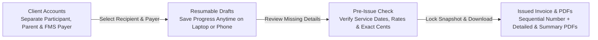

# This Week on NeuroHub: Client Billing, Itemized PDF Invoices, and Faster Directory Search

NeuroHub brings California Regional Center and Self-Determination Program (SDP) paperwork into one organized workspace—helping families manage Individual Program Plans (IPPs), prepare Traditional reimbursement packets and SDP budgets, and coordinate with their care team.

Here is a look at the product updates that went live this week.

---

## 1. Client Billing & Itemized PDF Invoices for Providers and Facilitators

Reconstructing session dates from notebooks, calendars, and text threads at the end of the month—just to format a clean invoice for a parent or Financial Management Services (FMS) bill-payer—takes hours away from actual care.

Most generic invoicing tools assume the person receiving a service is the same person paying the bill. In Regional Center and SDP care, one parent may coordinate services for two siblings with separate plans while an FMS intermediary or parent guarantor handles payment—and a single missing date or unclear total can stall payment or reimbursement for weeks.

Inside the provider workspace at **[https://neurohubcare.com/providers/invoices](https://neurohubcare.com/providers/invoices)**, providers and Independent Facilitators can now:

- **Separate the Participant from the Payer:** Create manual client billing accounts in **Clients** (`https://neurohubcare.com/providers/clients`) with distinct fields for the participant (including separate accounts for siblings in the same household) and the responsible parent/guarantor or FMS intermediary—whether or not the family uses NeuroHub.
- **Save & Resume Drafts on Laptop or Phone:** Jot down billable hours or sessions whenever you have a spare minute, or ask **Ninja** to prepare a draft from your notes and open the review screen with any missing details highlighted. Drafts stay private to your practice and post nothing until you choose to issue them.
- **Download Detailed & Summary PDFs:** Issuing an invoice assigns a sequential invoice number, locks an exact to-the-cent snapshot so future rate edits never alter past bills, and generates both a **Detailed session-by-session PDF** and a **Summary PDF** ready to download and attach to your regular family or FMS billing email.
- **Void & Replace Safely Before Payment:** Caught a typo or wrong service date before any outside payment occurred? Practice owners can void an issued invoice (preserving the audit trail) and immediately open a pre-filled replacement draft, with clear role boundaries between owners, billing staff, and clinicians.

### Honest Totals Today—and What Is Coming Soon
The workspace displays your **Recorded Invoice Total** (issued invoices minus any voided invoices). Because payments from families and FMS firms still happen outside NeuroHub today, this total is labeled explicitly rather than estimating an unpaid balance. Direct invoice email sending, recording received payments, overdue aging views, FMS-specific templates, and a client billing portal are coming soon.

---

## 2. Faster, More Forgiving California Directory Search

Searching NeuroHub's index of **7,100+ independent California service providers, Independent Facilitators, Family Resource Centers, and Special Education CACs** at **[https://neurohubcare.com/directory](https://neurohubcare.com/directory)**—with additional providers and community resources added continuously—is now significantly faster and handles everyday phrasing and typos much more smoothly when looking up a local provider, specialty, or Regional Center resource.

---

## 3. Streamlined First Step on Account Setup

On **[https://neurohubcare.com/home/get-started](https://neurohubcare.com/home/get-started)**, saving your starting plan on Step 1 now carries your email cleanly through account creation and sign-in so you never have to enter it twice.
